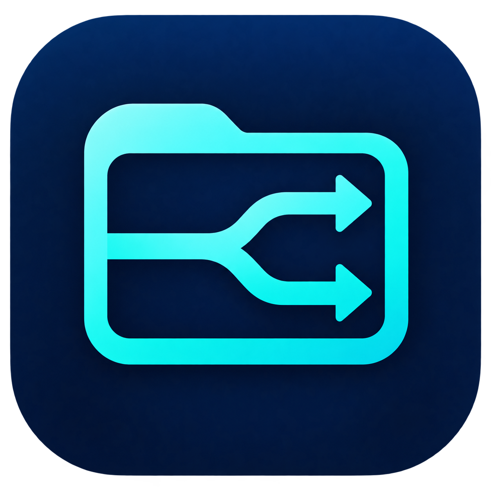

<p align="center">
  
</p>

<h1 align="center">Codex Project Router</h1>

<p align="center">
  <strong>Project-aware account routing for Codex desktop, with a native macOS companion</strong>
</p>

<p align="center">
  <a href="package.json"></a>
  <a href="companion/Package.swift"></a>
  <a href="companion/Package.swift"></a>
  <a href="LICENSE"></a>
</p>

<p align="center">
  <a href="#build-and-run">Build and run</a> ·
  <a href="#everyday-use">Everyday use</a> ·
  <a href="docs/operating-guide.md">Operating guide</a> ·
  <a href="companion/README.md">Companion reference</a>
</p>

## About

**Codex Project Router** is an experimental local proxy that identifies the
project associated with a Codex desktop request and selects its configured
account and HTTPS destination. The native menu-bar companion manages account
setup, an explicit default, project-routing On/Off, and guarded recovery.

This is an independent project. It relies on observed internal request headers
and local desktop state. Local test results do not establish compatibility with
every desktop version, gateway, or account; see the [validation evidence](#validation-and-limits).

## Features

- **Project-aware selection:** Resolve projects from explicit desktop assignments
  and saved subagent ancestry, without inspecting prompts or inferring projects
  from the active window or working directory.
- **Accounts and an explicit default:** Create or import named account settings,
  add accounts, and choose a default. Incoming credential verification remains
  separate from the selected outgoing account.
- **Everyday routing controls:** New managed starts begin Off. On applies saved
  project overrides; identified projects without an override inherit the default.
  Off uses the default through the running router.
- **Native companion:** Search projects and assign, switch, or remove an existing
  account override, with separate saved/running state and setup,
  activation, and recovery available from the same controls window.
- **Local credential handling:** Configuration stores Keychain references; request
  credentials are retrieved from the configured file-backed macOS Keychain items.
- **Explicit recovery:** Restore the preserved direct connection before safely
  stopping a router that Codex may still need.

## Build and run

### Prerequisites

- **macOS and Node.js 24**, with npm.
- **For the companion:** Apple silicon and a Swift 6 toolchain. Its package declares
  macOS 14+; this deployment target does not imply verification on every OS version.
- An existing compatible Codex HTTP Responses provider with a command-backed
  authentication helper and `supports_websockets = false`.
- The desktop state structures described in the [operating guide](docs/operating-guide.md#requirements-and-installation).

### Install and build the companion

```sh
git clone https://github.com/Light2288/codex-project-router.git
cd codex-project-router
npm ci
npm run companion:build
open "dist/Codex Project Router.app"
```

The build produces a local, ad-hoc-signed app with its icons and router resources
bundled. It can be moved outside the checkout and still requires an installed
Node 24 executable. This is not a notarized distribution.

The standalone CLI needs no build or global installation. Its configuration and
commands are in the [operating guide](docs/operating-guide.md#run-activate-inspect-restore).

### Initial setup

1. Create a private configuration through the companion, or select/import an
   existing one. Keep it outside the checkout and application bundle.
2. Configure outgoing accounts, explicitly choose the default, and separately
   confirm the incoming Keychain item matching the token Codex already sends.
3. Choose **Start router (routing Off)** explicitly. Initial provider activation
   requires the companion's activation flow, a manual Codex restart, and a working
   response confirmed in the app.

Browsing or opening the app never starts routing. See [account and default setup](docs/operating-guide.md#account-and-default-setup)
for prerequisites, native key entry, import behavior, and save safeguards.

## Everyday use

Use **Turn project routing On** / **Turn project routing Off** after initial
integration. These switches affect subsequent requests without restarting Codex
or rewriting the provider URL. Existing streams keep their original selection.

**Off still needs the router listener.** It suspends project overrides and uses
the saved default; it does not restore direct settings or authorize Stop/Quit.
When recovery is required, use **Restore direct**, restart Codex, verify and
confirm a direct response, then stop the owned listener when permitted. Closing
the controls window leaves the companion running.

The navy icon appears in the Dock and **⌘Tab** while controls are open, including
when minimized or hidden. Closing controls returns the running app to the menu
bar; **Open controls…** brings it back. **Quit** from the Dock uses the same
guarded recovery checks. Pinned and recent Dock items follow your macOS settings.

Open a project to choose an existing account or **Use default**. **Save and apply**
updates the exact owned running router without an ordinary Codex restart; **Save**
is available when safely stopped and Direct, for the next explicit Start in Off.
Choosing the named default is still an explicit override; **Use default** removes
it. Off suspends overrides. A saved choice alone does not prove running application.
Unavailable control or uncertain outcomes block writes while preserving guarded
Direct recovery. See [assignment editing](docs/operating-guide.md#project-assignment-editing).
Account editing/deletion remains deferred.

## Documentation

| Guide | What it covers |
| --- | --- |
| [Operating guide](docs/operating-guide.md) | Private configuration, account setup, standalone CLI, activation, recovery, compatibility, optional policies, and desktop validation |
| [Companion reference](companion/README.md) | Native setup, lifecycle, local bridge, packaging, and recovery details |
| [Schema-2 example](examples/router.accounts.example.json) | Synthetic incoming/default roles, account destinations, and project routes |
| [Credential-routing example](examples/router.credentials.example.json) | Schema-1 credential routing compatibility |
| [Branding artwork](assets/branding/README.md) | Original artwork provenance and native icon regeneration |

## Validation and limits

The [desktop identification report](docs/validation/desktop-project-identification-validation.md)
records the primary chat lifecycle observations. [Auxiliary metadata validation](docs/validation/auxiliary-request-metadata-validation.md)
found title requests with temporary IDs whose project origin could not be proven;
these remain blocked by default. The optional [narrow initial-title policy](docs/operating-guide.md#optional-unassigned-initial-title-policy)
allows qualifying requests without project attribution.

Current account/default setup evidence and its remaining native/live limits are
recorded in the [account setup validation](docs/validation/companion-account-default-setup.md).
Historical reports retain their original scope. Readiness, configured account
selection, Keychain access, desktop-loaded settings, gateway acceptance, and billing
attribution are separate facts.

The [assignment-editing validation](docs/validation/companion-project-assignment-editing.md)
records automated coverage, bounded human native/live observations, exact recovery
and cleanup separately from the pending final whole-branch review.

The listener is loopback-only. Keep actual endpoints, mappings, credentials,
Keychain references, backups, and runtime evidence outside Git. Unresolved or
conflicting identity does not gain authority through default inheritance. The
router adds no model-request retries, alternate-account fallback, or redirect following.

## Development checks

From the repository root:

```sh
npm run companion:test
npm run companion:build
npm test
npm run companion:package-test
node --check src/cli.js
git diff --check
```

Tests use synthetic desktop state and local upstreams. Package checks exercise
the relocated signed app, bundled images, and an owned disposable Keychain with
public test fixtures. They preserve existing user items and the default Keychain;
see the [verification details](docs/operating-guide.md#development-checks).

## License

Distributed under the [MIT license](LICENSE). Copyright © 2026 Light.
