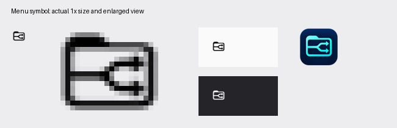
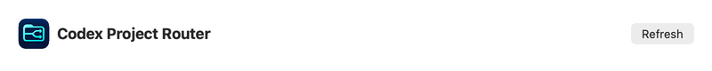

# Companion branding and README validation

**Date:** 2026-11-14  
**Scope:** [Approved specification](../superpowers/specs/2026-11-14-companion-branding-readme.md) and [separately approved plan](../superpowers/plans/2026-11-14-companion-branding-readme.md). Native execution in the existing checkout on `chore/companion-branding-readme`, based on `5be89ca45ca4d50824827eed37063236a6c0f8ff`.

## Observed acceptance

The final acceptance sequence ran after switching the SwiftUI images to native
AppKit resource loading. Every command exited 0:

| Command | Decisive result |
| --- | --- |
| `npm run companion:test` | 176 Core and 62 App tests passed; 238 total, zero failures |
| `npm run companion:build` | Built and ad-hoc signed `dist/Codex Project Router.app` |
| `npm test` | 817 passed; zero failed, cancelled, or skipped |
| `npm run companion:package-test` | 3 passed; zero failed, cancelled, or skipped |
| `node --check src/cli.js` | No syntax errors |
| `git diff --check` | No whitespace errors |

Build diagnostics were the existing file-backed Security API deprecation
warnings. No new runtime dependency was added.

The initial packaging regression failed on the absent branding resources and
app-icon declaration before implementation; the completed integration passes.

The package tests exercised the exact resource allowlist, corrupt PNG rejection,
missing-resource build errors, native image decoding, transparency, app icon
sizes, menu image template metadata and logical dimensions. Relocated copies
passed `codesign --verify --deep --strict`. Native image lookup also passed in a
macOS Seatbelt process denied reads of the checkout, including lexical, resolved,
and symlink paths. The existing synthetic lifecycle checks retained their
isolated configuration, owned process groups, bounded termination, disposable
Keychain cleanup, and port-reuse assertions. All passed.

## Artwork identity and preparation

The repository originals match the supplied Downloads files byte-for-byte:

| File | SHA-256 |
| --- | --- |
| `assets/branding/codex-project-router.png` | `dce0a2d6e486622ed741b902eb3c43d71f2b5d685d24aa82726d6ca40725723b` |
| `assets/branding/menu-bar-source.png` | `71343bcb526218ab25a0a9f06a525f5986b68a34d8cecd556874f978a9561d1d` |
| `companion/Resources/AppIcon.icns` | `729568e41a5dc37512324a4b1a604a24b21feadbcf9da27e25183cf0abe09757` |
| `companion/Resources/CompanionIcon.png` | `dce0a2d6e486622ed741b902eb3c43d71f2b5d685d24aa82726d6ca40725723b` |
| `companion/Resources/MenuBarIconTemplate.tiff` | `ab61605ff0b7f10da013d254f61172b13dd0f6c3965050f37473ad7cdbf3c026` |

Repeated native regeneration produced the same three resource hashes. The ICNS
includes 16, 32, 64, 128, 256, 512, and 1024-pixel dimensions, including standard
normal/Retina representations. The menu TIFF contains 26 × 18 and 52 × 36-pixel
frames and loads as a 26 × 18-point template. The navy header remains full color.
See [provenance and regeneration](../../assets/branding/README.md).

**Ruling:** The menu source has alpha-1 noise beyond its visible mark. Crop
bounds therefore use alpha ≥16/255, plus a one-source-pixel antialias guard. A
first generated image failed the effective-symbol-height assertion; the corrected
crop passed. This preserves the original file and visible geometry. The cost if
the threshold is unsuitable is exclusion of exceptionally faint outer pixels.

## Visual and documentation observations

The actual-size menu silhouette remains readable in inspected black-on-light and
white-on-dark previews. Native decoding confirms transparent corners. These are
size/color previews rather than captures of the running system menu bar.

Offscreen rendering of the actual `ControlsView` header exposed that SwiftUI's
named-image initializer omitted the loose bundled PNG even though AppKit could
load it. A comparison rendered the native image while omitting the named-image
variants. Both UI surfaces now use `Image(nsImage:)` with native resource lookup.
The header pixel check failed before this correction and passed afterward. The
menu label retains a contextual logged fallback to the original routing symbol.

The header below was rendered from the same source, with module imports flattened
only in a scratch harness and isolated temporary storage. The 36-point icon sits
beside the title without obscuring Refresh. Its decorative accessibility hiding
and the menu label's accessible app name are retained in source.

The README was inspected in a browser-rendered Markdown preview: the logo and
badges loaded and the introductory layout rendered. A local check passed all
52 link/image targets and fragment anchors in the README, operating guide,
companion reference, and artwork guide. All 11 original README sections remain
in the operating guide. Legacy standalone schema-1 wording was clarified against
existing managed default inheritance; no routing behavior changed.

## Limits

No installation or replacement of the running companion was performed. Finder
icon-cache refresh for an existing installation, a live status-bar appearance,
human accessibility testing, and a full interactive controls-window walkthrough
are unobserved. The offscreen header does not establish full-scroll-view
rendering. Synthetic/native package results do not establish live gateway
compatibility, billing attribution, or every macOS version's behavior. Real
private configuration and the existing companion session were not changed.

## Final review

The required integrated specification-then-quality review is pending. Its
identity and findings will be recorded here after both stages finish.
