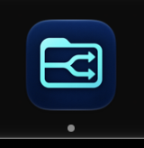
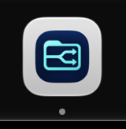

# Companion icon rendering validation

**Date:** 2026-11-15

**Specification:** [Approved scope](../superpowers/specs/2026-11-15-companion-icon-rendering.md)

**Plan:** [Separately approved plan](../superpowers/plans/2026-11-15-companion-icon-rendering.md)

**Branch:** `fix/companion-icon-rendering`

**Baseline:** `b1c6e56e96a57f3f51e752234c5cacca9aff7b62`

The user clarified that the complete navy tile and folder constitute the icon,
confirmed the corrected scope with “confirmed,” then separately approved the
saved specification and subsequently the saved plan with distinct “approved”
messages. Both approved artifacts were committed as `bda0aeb` before product
edits. Native execution retained the session model. Fetch confirmed local
`main` and `origin/main` were equal; the implementation branch preserves the
unmerged branding and Dock-presence history. No worktree was created.

## Delivered correction

The bundle now declares the native `AppIcon` catalog entry and includes
`Assets.car`, compiled by Apple's `actool` from a single flattened Icon Composer
document. The complete navy tile is normalized to the native canvas, without
independently scaling the cyan folder. macOS supplies the outer mask and edge
treatment. The original ICNS remains as a legacy fallback and the declared
deployment minimum remains macOS 14.0.

The original PNG's navy pixels mostly have alpha 252–253. The derived native
canvas unpremultiplies those pixels before making them opaque, and extends only
the transparent perimeter with adjacent navy. Its opacity and measured folder
position/extent pass native image checks. Source images, legacy ICNS, menu-bar
TIFF, header PNG, and root README are unchanged byte-for-byte.

Implementation and regression coverage were committed as `eec62da`.

## Actual Dock evidence

The user's original screenshot shows the additional gray container:

The fresh canonical app was launched by its uninstrumented executable path in
isolated native state. Its Dock icon now shows the navy rounded-square surface
without an extra gray container:

The after image is a direct crop of an actual Dock screenshot, without image
replacement or compositing. The full temporary frame showed its navy tile at
the same ordinary size as neighboring app tiles. This is distinct from an Icon
Composer preview or a raw PNG/ICNS decode.

A controlled replay used the same application code in separate disposable
bundles with fresh verification-only identities and ad-hoc signatures. The old
ICNS-only bundle reproduced the gray container:

The native catalog bundle showed the full navy surface. An earlier replay using
the shared production bundle identity had inherited an unframed presentation,
so the fresh identities were necessary to distinguish the packaging result from
shared-identity icon caching. Neither replay changed the canonical bundle or
reset any system cache. The evidence supports fixing the legacy compatibility
presentation with the native catalog and mask-ready canvas; it does not imply
that every legacy ICNS always receives a gray container.

The observation checked the exact canonical bundle path, synthetic
`instance.lock`, regular activation policy, on-screen controls window, unchanged
synthetic state, and absence of a created router configuration. Only the owned
test process/group was stopped. The image matches the canonical build's bundled
native resource; it is not an instrumented app.

Screen capture was already authorized; Accessibility/event posting was not.
Initial captures missed the auto-hidden Dock. The user manually revealed it;
the successful capture window included both displays and found the visible Dock
on the built-in display. No system permission, Dock preference, custom Finder
icon, or system-wide icon cache was changed.

## Regression and automated acceptance

Before implementation, the existing native source-denied package case failed
because the canonical `dist` app was the older build without regular Dock
presence. The baseline Node suite was 816/817, and package checks were 2/3,
with that sole stale-build failure. All 176 Core and 67 App tests passed.

After adding the native icon expectations and before production edits, all
three package cases failed on missing `Assets.car` or the missing native icon
declaration. The new artwork check also rejected a first normalization attempt
that assumed source pixels were opaque. Correctly handling the measured source
alpha made it pass without relaxing the composition/opacity assertions.

Final combined acceptance ran from the existing checkout with Node 24.21.0:

| Command | Observed result |
| --- | --- |
| `swift scripts/generate-companion-icons.swift` | Native catalog compiled with Xcode 27.2 and macOS 14.0 target; legacy/header/menu outputs preserved |
| `npm run companion:test` | 176 Core + 67 App tests passed; 243 total, zero failures |
| `npm run companion:build` | Fresh release app built and ad-hoc signed |
| `npm test` | 817 passed; zero failed, cancelled, or skipped |
| `npm run companion:package-test` | All 3 passed; zero failed, cancelled, or skipped |
| `node --check src/cli.js` | Exit 0; no syntax errors |
| `git diff --check` | Exit 0; no whitespace errors |

Catalog-only lookup succeeds from a disposable assembled bundle with the ICNS
removed, preventing fallback from masking a broken catalog. Corrupt and missing
catalogs fail with resource-specific diagnostics; the synthetic builder rejects
a missing catalog. Existing corrupt-header and missing-menu checks remain.
The derived canvas is opaque at every pixel. Its cyan bounds preserve the
hand-measured source extents and position within two output pixels.

Package checks retain explicit allowlists, regular-file checks, strict signing,
arm64/minimum metadata, relocation, checkout-read denial, native window/regular
policy, isolated credentials/configuration, byte-exact routing rollback, zero
control-time upstream connections, owned process-group cleanup, and reusable
synthetic ports. Only existing file-backed Security API deprecation diagnostics
were emitted. No application, controller, or routing source was modified.

## Bundle consolidation and preserved assets

Before rebuilding or removing a bundle, process inspection confirmed neither
exact affected `dist` path was running. After automated and actual Dock
acceptance, the obsolete `Codex Project Router Dock Preview.app` was removed.
Only `dist/Codex Project Router.app` remains among app bundles in `dist`; unrelated
output was preserved. Its strict signature and resource equality were checked.

| Resource | SHA-256 |
| --- | --- |
| Packaged `Assets.car` | `dded31a86a1c5712dfc8556544311f1b5b01f797713ace43493b249534069147` |
| Original navy PNG and unchanged header PNG | `dce0a2d6e486622ed741b902eb3c43d71f2b5d685d24aa82726d6ca40725723b` |
| Original menu source PNG | `71343bcb526218ab25a0a9f06a525f5986b68a34d8cecd556874f978a9561d1d` |
| Unchanged legacy ICNS | `729568e41a5dc37512324a4b1a604a24b21feadbcf9da27e25183cf0abe09757` |
| Unchanged menu-bar TIFF | `ab61605ff0b7f10da013d254f61172b13dd0f6c3965050f37473ad7cdbf3c026` |

## Limits and rulings

The actual Dock check establishes the final presentation on macOS 27.0.1.
macOS 14 execution was unobserved; the minimum declaration, compiler target,
and legacy representations are retained. Icon appearance under every system
tint/clear preference was not exhaustively exercised.

**Ruling:** The baseline missing-regular-policy failure was treated as the
reported stale canonical artifact, rather than an unrelated new lifecycle bug.
The fresh latest build passed the full native and package checks; if that
interpretation were wrong, those checks would need to expose another lifecycle
defect. Earlier historical review records were not rewritten.

## Final review

The sole integrated review passed in order:

- **SPEC REVIEW: PASS** — AC-01–AC-08 supported; no missing or extra work.
- **QUALITY REVIEW: PASS** — no findings. Expected/current/spec-PASS identities
  matched, the package was unchanged, and all 16 changed-file hashes matched.

Both reviewers were read-only and did not rerun tests. No fix pass or deferred
minor was needed. The image evidence and verification limits were reviewed.

- `GATE_RUN_ID`: `96f2072d-2f95-4458-aaef-ca1329ae554c`
- `REVIEWED_STATE_ID`: `26eee140-5d75-42da-be6f-a4924a1a4a53`
- `PACKAGE_SHA256`: `0503cd2a0b03b201ed314ab41f493dd4e94584967b3ac943018aec4e7f3fbe74`
- Reviewed implementation/documentation HEAD: `6f107c18ce7509c616d51cc18ab220ad7e54d352`

Subsequent changes only record review outcomes and completed lifecycle/checklist
metadata. The approved endpoint is reached: one verified canonical bundle,
local commits, and the existing checkout preserved, without installation,
push, merge, or another increment.
